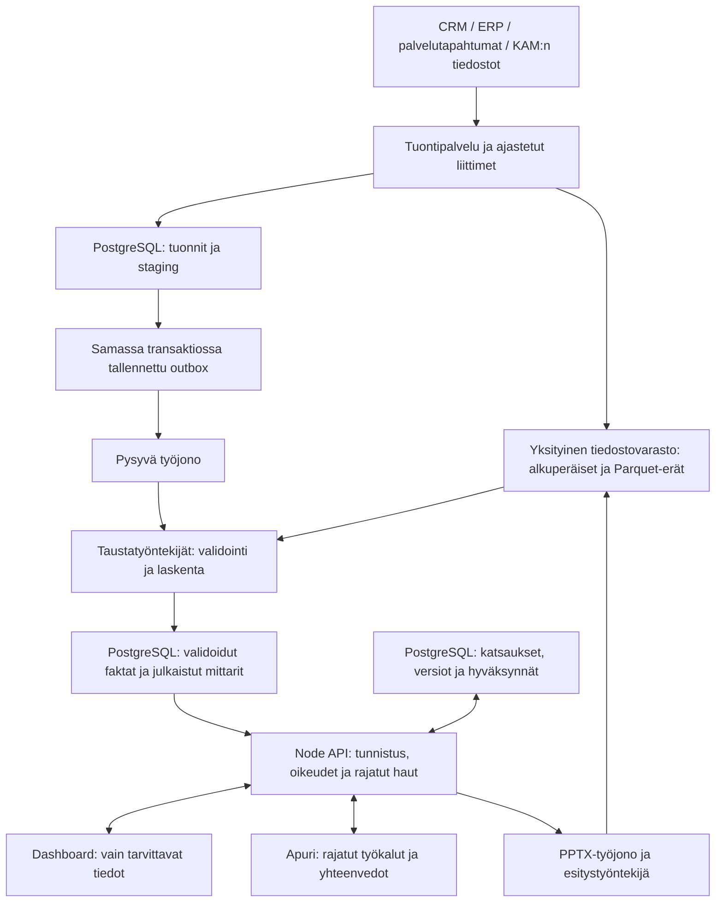

# Tuotantobackendin suunnitelma

Päiväys: 2026-11-07. Omistaja: kopperoinenp. Tila: ehdotus toteutuksen pohjaksi.
Tämä dokumentti ei muuta nykyisiä rajapintoja, skeemoja, käyttöoikeuksia tai infrastruktuuria.
Teknologiavalinnat, datan omistajuus ja tuotannon vaatimukset vahvistetaan ennen toteutusta.

## Tavoite ja lähtökohta

Useat KAM:t käyttävät samaa asiakasdataa käyttöoikeuksiensa mukaisesti. Analyysit
lasketaan taustalla, ja dashboard saa vain rajatut, valmiit tulokset. Asiakasdata voi
olla yhteensä satoja gigatavuja; yhden sivupyynnön työmäärä ei saa kasvaa sen mukana.

Nykyinen buildless-käyttöliittymä ja Node-backend voidaan säilyttää. Muutettavia kohtia
ovat selaimen `data.js`-aineisto ja laskenta, backendin muistissa oleva dataset,
prosessikohtaiset busy-liput, paikallinen review-store ja muistissa säilytettävät PPTX:t.
Nykyinen tiedostotuonti on analyysidemonstratio, ei yhteinen tuotantodatan tallennusputki.

Suunnitteluoletukset: ensimmäisessä tuotantovaiheessa tuntien tai vuorokauden
päivitysviive on hyväksyttävä; dashboard ei edellytä reaaliaikaista skannausvirtaa.
Kokonaisdatamäärä, tapahtumien määrä, päivitysnopeus, käyttäjämäärä, tietojen
säilytysajat ja alueelliset vaatimukset ovat vielä vahvistamatta. Alla olevat
suorituskykyluvut ovat testattavia tavoitteita, eivät lupauksia tai mitattuja tuloksia.

## Rakenne

Aluksi yksi modulaarinen Node-palvelu sekä erikseen ajettavat työntekijäprosessit samasta
projektista. HTTP-palvelinta ja laskentaa skaalataan erikseen. Pythonia voidaan käyttää
olemassa olevan tiedostonlukijan kaltaisissa eristetyissä laskentatöissä ilman koko
backendin uudelleenkirjoitusta. Uusi frontend-kehys tai mikropalvelujako ei ole edellytys.

| Osa             | Vastuu                                                                                       |
| --------------- | -------------------------------------------------------------------------------------------- |
| PostgreSQL      | Asiakkaat, oikeudet, tuontien metadata, aktiivinen faktadata, valmiit mittarit ja katsaukset |
| Tiedostovarasto | Alkuperäiset CSV/XLSX-tiedostot, suuret historiat, Parquet-erät ja valmiit esitykset         |
| Pysyvä jono     | Tuonti-, laskenta- ja vientityöt; viiveet, uudelleenyritykset ja epäonnistuneet työt         |
| Työntekijät     | Aineiston tarkistus, muunnokset, rajatut uudelleenlaskennat ja tiedostojen luonti            |
| Node API        | Käyttäjätunnistus, asiakaskohtaiset oikeudet, yhteenvetohaut ja katsauksen muokkaukset       |
| Selain          | Valmiiden tulosten esittäminen ja KAM:n muokkausten lähettäminen                             |

Mahdollinen Azure-toteutus: hallittu PostgreSQL, Blob Storage, Service Bus, API ja
työntekijät konttipalvelussa sekä organisaation hyväksymä OIDC-kirjautuminen, esimerkiksi
Entra ID. Tämä on esimerkkikartoitus, ei päätös pilvialustasta tai palvelutasoista.
Erillinen Redis-välimuisti lisätään vasta, jos mittaukset osoittavat tarpeen.

## Tallennettavat tiedot

Raakatiedostot eivät kuulu suuriin tietokannan BLOB-sarakkeisiin. Tietokannassa on
niiden metatiedot ja viitteet; analyysiin käytettävät rakenteiset tiedot ovat yhteisessä
tietomallissa. Jokainen asiakas kuuluu organisaatioon (`tenant`). Sama tenant voi
sisältää monta asiakasta ja käyttäjää, joilla on erilaiset asiakasoikeudet.

| Taulu / kokonaisuus                                | Olennaiset tiedot                                                                                                   |
| -------------------------------------------------- | ------------------------------------------------------------------------------------------------------------------- |
| `tenants`, `users`, `customer_access`              | Organisaatio, ulkoisen kirjautumisen käyttäjätunniste, asiakas ja rooli                                             |
| `customers`, `sites`, `products`                   | Asiakkaan yhteiset perustiedot sekä lähdejärjestelmien tunnistekartoitukset                                         |
| `imports`, `import_files`                          | Asiakas, lähettäjä, tallennusviite, tarkistussumma, lähde, tila, rivimäärät ja virheet                              |
| `dataset_versions`, `dataset_version_inputs`       | Muuttumaton laskennan syötekokonaisuus: mukana olevat lähde-erät ja korvaus-/lisäyssäännöt                          |
| Faktataulut                                        | Palveluaktiviteetti, huoltokierrot, korjaukset ja tekstiilien määrätilanteet omilla luonnollisilla rakeisuuksillaan |
| `metric_definitions`, `analysis_runs`              | Mittarin versio, yksikkö, rajaus, laskentaohjelman versio ja syöteversio                                            |
| `customer_metrics_monthly`, `site_metrics_monthly` | Jaksosummat, suhteiden osatekijät ja snapshot-tiedot; lähde- ja laskentaviitteet                                    |
| `reviews`, `review_versions`                       | Omistaja, näkyvyys, asiakkaan tunnus, muokkausrevisionumero, rakenne ja KAM:n muokkaukset                           |
| `opportunities`, `opportunity_approvals`           | Sääntö, havainto, syöte-/mittariversio, hyväksyjä, tila ja hyväksymisaika                                           |
| `presentation_jobs`, `presentations`               | Katsausversio, mittariversio, tila, malliversio, tiedostoviite ja säilytysaika                                      |
| `jobs`, `outbox`, `audit_events`                   | Työn tila, lähettämättömät tapahtumat sekä tekijä- ja muutoshistoria                                                |

Asiakkaaseen kuuluvilla riveillä on sekä `tenant_id` että `customer_id`. Avaimet ja
viiteavaimet estävät saman tenantin sisälläkin toisen asiakkaan toimipisteen liittämisen
väärään aineistoon. Indeksit suunnitellaan asiakas-, toimipiste- ja aikarajausten mukaan.
Suuria tapahtumatauluja voidaan jakaa kuukausiosiin todellisen kyselykuorman perusteella.
Yksi taulu tai fyysinen osio jokaista asiakasta varten ei ole oletusratkaisu.

Katsauksen joustava rakenne voi olla validoitu JSONB-dokumentti. Faktat ja mittarit
ovat tyypitettyjä sarakkeita, eivät mielivaltaista JSON-sisältöä. KAM:n säästöarvio
tallennetaan erillisenä manuaalisena arviona tekijän ja ajan kanssa; se ei muuta faktadataa.

## Datan tuonti ja taustalaskenta

1. Käyttäjä kirjautuu ja valitsee asiakkaan. Backend tarkistaa tuontioikeuden ja luo
   tuonnin sekä palvelimen määräämän tallennuskohteen. Pelkkä asiakkaan valinta ei
   todista aineiston kuuluvan asiakkaalle: tunnisteet ja lähteen omistajuus tarkistetaan.
2. Tiedosto siirretään rajatulla, lyhytikäisellä latausluvalla suoraan yksityiseen
   tiedostovarastoon. Suurten lähdejärjestelmien tuonnit tehdään ajastetuilla liittimillä,
   sivutettuina tai jatkettavina erinä; koko aineisto ei kulje selaimen eikä HTTP API:n muistin kautta.
3. Backend vahvistaa siirron valmistumisen ja tarkistaa tallennusviitteen, koon,
   tarkistussumman ja oikeudet. Tuontityö ja outbox-tapahtuma tallennetaan samassa
   tietokantatransaktiossa. Lähettäjä toimittaa tapahtuman jonoon.
4. Työntekijä tarkistaa tiedoston turvallisuuden, koon, pakatun sisällön rajat, rakenteen,
   asiakkaan tunnisteet, yksiköt, ajanjaksot ja duplikaatit. XLSX käsitellään eristetyssä
   työssä; suurissa tuonneissa suositaan pilkottua CSV:tä tai Parquetia.
5. Tiedot muunnetaan staging-alueelle. Tunnistamaton asiakasyhteys tai vahvistamaton
   sarakekartoitus jää karanteeniin tarkistettavaksi. Tuotannossa sitä ei julkaista
   automaattisesti vain siksi, että tiedostossa ei näy ristiriitaista asiakastunnusta.
6. Lähteen oikeat tapahtumatunnisteet, lähdeversiot ja korvaussäännöt estävät saman
   tapahtuman laskemisen uudelleen. Kaksi samansisältöistä korjausta voi silti olla
   kaksi oikeaa tapahtumaa: pelkkä rivisisällön yhtäläisyys ei ole poistoperuste.
7. Laskenta päivittää vain muuttuneet asiakkaat, toimipisteet ja aikajaksot sekä niistä
   riippuvat vertailut ja mahdollisuusehdotukset. Myöhäiset korjaukset ja poistot huomioidaan.
8. Uusi julkaisuversio saa tilan `ready` vasta tarkistusten valmistuttua. Dashboardin
   aktiivinen versioviite vaihdetaan atomisesti. Lukija ei saa puoliksi vanhoja ja
   puoliksi uusia mittareita. Edellinen valmis versio pysyy käytettävissä epäonnistumisessa.
9. Käyttöliittymä näyttää työn etenemisen, virheet, kattavuuden ja viimeisimmän valmiin
   version ajan. Tilat voidaan hakea kyselyllä; SSE on myöhempi käyttömukavuusparannus.

Saman asiakkaan rinnakkaiset tuonnit sarjoitetaan julkaisussa tai julkaisu käyttää
edeltävän version vertailua ja uudelleenyritystä. Hitaammin valmistuva vanha työ ei saa
korvata uudempaa julkaisua. Faktakorjauksista säilytetään versioitu historia, jotta
vanhaan julkaisuun sidotut tarkemmat haut ja esitykset eivät lue uusia arvoja vanhojen
yhteenvetojen rinnalle. Versiomanifestit viittaavat olemassa oleviin eriin; jokainen
päivitys ei tarkoita koko satojen gigatavujen aineiston kopiointia.

Jonon toimitus käsitellään vähintään kerran -mallina. Työntekijä on idempotentti:
sama työavain ei julkaise kahta versiota tai kahdenna lukuja. Avaimessa ovat tenant,
asiakas, syöteversio ja laskentaversio. Uudelleenyritykset, rajoitettu yritysmäärä,
epäonnistuneiden töiden jono ja valvottu uudelleenkäynnistys kuuluvat toteutukseen.
Jonon mahdollinen duplikaattien tunnistus ei korvaa tietokannan yksikäsitteisyysrajoja.

## Mittareiden oikeellisuus ja suorituskyky

- Pesumäärät ja korjaustapahtumat summataan sovitulla aikarajauksella.
- Vaatemäärä on viimeisin soveltuva snapshot, ei kuukausien summa. Jos toimipisteiden
  snapshot-ajat eroavat, kattavuus ja poikkeavat ajat esitetään eikä summaa nimetä
  harhaanjohtavasti yhdeksi ajantasaiseksi tilanteeksi.
- Skannausosuus lasketaan yhteisistä osoittajista ja nimittäjistä, ei toimipisteprosenttien
  keskiarvona. P90-lukuja ei yhdistetä laskemalla kuukausi-P90:ien keskiarvoa:
  tarvitaan tapahtumat tai yhdistelemiseen soveltuva, dokumentoitu jakauma-arvio.
- Puuttuva arvo ei muutu nollaksi. Vertailussa varmistetaan samat kuukaudet,
  mittariversiot ja laskentarajaukset. Arviot erotetaan mitatuista luvuista.
- Oletusnäkymä lukee valmiita kuukausimittareita. Tarkemmat tapahtumahaun vastaukset
  ovat sivutettuja ja aikarajattuja. Raskas uusi analyysi on taustatyö, ei avoin SQL-haku.
- Kylmä historia säilytetään pakattuina ositettuina tiedostoina. PostgreSQL:ssä
  pidetään dashboardin tarvitsema aktiivinen faktadata ja palvelutason mukaiset yhteenvedot.
  Tietovarastomoottori lisätään vasta, jos kuormitus osoittaa laajojen historiakyselyjen
  ylittävän tämän ratkaisun rajat. Satojen gigatavujen koko ei yksin ratkaise moottoria.

## Dashboardin ja katsauksen rajapinnat

Alla on ehdotettu uusi versionoitu sopimus, ei muutos nykyisiin reitteihin. Nykyinen
käyttöliittymä siirretään siihen sovitin kerrallaan. Asiakas-, organisaatio- ja
omistajatiedot valtuutetaan palvelimella joka pyynnössä.

| Pyyntö                                                                  | Tarkoitus                                                              |
| ----------------------------------------------------------------------- | ---------------------------------------------------------------------- |
| `GET /api/v1/customers?cursor=...&limit=50`                             | Vain käyttäjälle sallitut asiakkaat                                    |
| `POST /api/v1/customers/{id}/imports`                                   | Tuonnin luonti ja rajattu siirtolupa                                   |
| `POST /api/v1/imports/{id}/complete`                                    | Valmiin siirron vahvistus; palauttaa `202` ja työn tunnuksen           |
| `GET /api/v1/jobs/{id}`                                                 | Työn tila ja asiakkaalle turvalliset virhetiedot                       |
| `GET /api/v1/customers/{id}/dashboard?from=2025-01&to=2025-12&site=all` | Rajattu yhteenveto, kattavuus, päivitysaika ja julkaisuversio          |
| `GET /api/v1/customers/{id}/metrics/water?version=...&grain=month`      | Sallittu aikasarja samasta versiosta                                   |
| `GET /api/v1/customers/{id}/reviews`                                    | Käyttäjän omat ja hänelle jaetut katsaukset                            |
| `PATCH /api/v1/reviews/{id}`                                            | Validoitu muutos; revision tarkistus / `If-Match`, ristiriidassa `409` |
| `POST /api/v1/reviews/{id}/opportunities/{opportunityId}/approve`       | Nimenomainen KAM-hyväksyntä sidottuun havaintoversioon                 |
| `POST /api/v1/reviews/{id}/presentations`                               | Hyväksytystä versiosta taustatyö; palauttaa `202`                      |
| `GET /api/v1/presentations/{id}/download`                               | Oikeustarkistus ja rajattu tiedoston latauslupa                        |

Dashboard-vastaus sisältää esimerkiksi `customerId`, `datasetVersion`,
`calculationVersion`, `updatedAt`, `scope`, `kpis`, `series`, `coverage` ja `warnings`.
KPI:n mukana tulevat yksikkö, periodi/snapshot-aika, lähdeviite ja arvio-/mittaustila.
Samaan näkymään liittyvät lisähaut käyttävät samaa versiota. ETag voi vähentää turhaa
siirtoa; välimuistiavain sisältää oikeusrajauksen, asiakkaan, version ja suodattimet.

Selaimen kokonaista `data.js`-latausta ei jätetä taustalle fallbackiksi. Myös suodattimien
valinnat, asiakashaku ja toimipistelistat saadaan rajatuista backend-vastauksista.

## Yhteinen asiakasdata ja KAM:n katsaukset

Yksi asiakkaan julkaistu aineistoversio on yhteinen kaikille siihen oikeutetuille.
Sen päälle voidaan tehdä omia katsausluonnoksia ja erikseen jaettuja tiimikatsauksia.
Oletusluonnos on käyttäjän oma; jakaminen on nimenomainen toiminto. Asiakkaan
virallinen katsaus julkaistaan nimettynä katsausversiona sovitulla hyväksyntäoikeudella.

KAM:n sisäiset muistiinpanot ja asiakassuhdearvio ovat erillisiä asiakasesityksen
sisällöstä, myös tietomallissa ja serialisoinnissa. Esityspalvelu saa vain
asiakkaalle hyväksytyt kentät. Muokkausrevision tarkistus estää toisen käyttäjän
muutosten hiljaisen ylikirjoittamisen; reaaliaikainen yhteiskirjoitus ei ole ensi vaiheen vaatimus.

Uusi aineistoversio ei poista KAM:n tekstejä. Katsaus näyttää uuden datan saatavuuden;
siirtyminen uuteen versioon tekee aiemmasta esityshyväksynnästä vanhentuneen.
Lisämyyntihyväksyntä sidotaan myös havaintoon, sääntö-/laskentaversioon ja rajauksiin,
jotta sitä ei sovelleta huomaamatta muuttuneeseen perusteluun. Vanha hyväksytty
esitys säilyttää alkuperäisen katsaus- ja mittariversionsa sovitun säilytysajan.

PPTX-työntekijä käyttää hyväksyttyä, muuttumatonta katsausversiota ja samaa
esitysmallia kuin esikatselu. Keskeneräinen luonti ei julkaise tiedostoa. Valmis PPTX
tallennetaan yksityiseen tiedostovarastoon; API tarkistaa oikeuden aina ennen lyhytikäisen
latausluvan antamista. Jo myönnetyn luvan voimassaolo ja peruutuskäytäntö määritellään erikseen.
Nykyinen prosessimuistin 10 minuutin tiedostosäilytys ei ole tuotannon tallennusratkaisu.

## Apuri ja käyttöoikeudet

Apuri saa vain valtuutettuja, rajattuja työkaluja, esimerkiksi `get_customer_summary`,
`compare_periods`, `get_site_metrics`, `patch_review` ja `propose_service_opportunities`.
Työkalut kutsuvat samaa palvelukerrosta kuin dashboard. Malli ei saa tietokantayhteyttä,
mielivaltaista SQL-suoritusta tai oikeutta hyväksyä esitystä käyttäjän puolesta.

Faktat lasketaan SQL:llä tai testatuilla laskentafunktioilla. Malli saa tarpeellisen
yhteenvedon, yksiköt, kattavuuden ja lähteet, ei koko raakadataa. Tiedostosisältö on
epäluotettavaa aineistoa, ei työkalujen käyttöohje. Mallin ehdottama uusi mittari tarvitsee
validoidun määrittelyn ja tarvittaessa dataomistajan hyväksynnän ennen virallista julkaisua.

OIDC-tunniste tarkistetaan palvelimella. Asiakasoikeudet tarkistetaan API:ssa,
taustatöissä, viennissä ja latauksissa. PostgreSQL:n rivitason säännöt ovat toinen
suojauskerros; sovelluksen tietokantarooli ei omista tauluja eikä saa `BYPASSRLS`-oikeutta.
Yhteyspoolissa oikeuskonteksti asetetaan transaktiokohtaisesti, ei vuotavana istuntoasetuksena.

Luottamukselliset tiedot erotetaan lokeista. Salaisuudet ovat salaisuuksienhallinnassa,
eivät selaimessa tai repossa. Tiedonsiirto ja tallennus salataan. Mallipalveluun
lähetettävät kentät, palveluntarjoajan ehdot, säilytysajat, alueet ja henkilötietojen
käsittely vahvistetaan organisaation tietojen omistajan kanssa ennen oikeita asiakastuonteja.

## Operointi ja hyväksymiskriteerit

Hallittu tietokanta, palautuspisteisiin perustuvat varmistukset ja testatut palautukset.
Tuotanto ja testaus ovat eri ympäristöjä; todellista asiakasdataa ei kopioida kehitykseen
oletuksena. Skeemamuutokset tehdään versioituina migraatioina ja taaksepäin
yhteensopivalla käyttöönotolla. Tiedostovaraston, indeksien ja johdettujen tietojen
säilytys- ja poistoprosessi kattaa saman asiakkaan kaikki kopiot.

Seuranta kattaa API-viiveen ja virheet, jonon iän, työn epäonnistumiset, tuonnin
kattavuuden, laskentaviiveen, tietokantakuorman sekä AI- ja laskentakustannukset.
Käyttäjäkohtaiset ja asiakaskohtaiset kiintiöt estävät yhden suuren tuonnin viemästä
kaikkia työntekijöitä. Esitystyöt ja aineistolaskenta käyttävät erillisiä jonoja tai prioriteetteja.

Alustavat, ennen pilottia vahvistettavat tavoitteet:

- Julkaistun asiakkaan dashboard-API:n p95 alle 1 s sovitussa vakiokuormassa.
- Näkymän ensimmäinen käyttökelpoinen sisältö alle 2 s sovitussa verkkoympäristössä.
- Enintään 200 kt oletusyhteenvedon vastaus; listat ja yksityiskohdat erikseen.
- Kuormitustesti esimerkiksi 500 Gt lähdehistorialla ja 100 samanaikaisella käyttäjällä.
  Nämä ovat suunnitteluskenaarioita: myös rivimäärät, suurimman asiakkaan koko ja
  todellinen kyselyjakauma on määriteltävä. Siirtovolyymi ei yksin riitä kuormakuvaukseksi.
- Tuonti, laskenta ja vienti jatkuvat turvallisesti työntekijän kaatumisen jälkeen.
- Kahdesti toimitettu tuontityö ei muuta mittarien tuloksia tai julkaise kahta versiota.
- Toisen asiakkaan oikeudeton haku, katsauksen muutos tai lataus estyy myös manipuloiduilla tunnuksilla.
- Sama katsaus- ja mittariversio tuottaa samat faktat dashboardiin, apurille ja PPTX:ään.
- Varmistuksesta palautus osoitetaan käytännössä; alustavat keskusteluarvot ovat
  RPO 15 min ja RTO 4 h. Todellinen palvelutaso ja kustannukset vahvistetaan erikseen.

## Toteutusjärjestys

1. **Yhteinen tallennus ja oikeudet:** kirjautuminen, tenant-/asiakasoikeudet,
   PostgreSQL ja yksityinen tiedostovarasto. Nykyiset katsaukset siirretään käyttäjään
   liitettävinä versioina; omistajuudeltaan tuntemattomia vanhoja tietoja ei jaeta automaattisesti.
2. **Pysyvä tuontiputki:** yksi oikea lähde, lähdekohtaiset tunnistekartoitukset,
   staging, työjono, idempotenssi ja virheraportointi. Vertailu nykyisen aineiston
   kontrollisummiin ja mittareihin ennen julkaisua.
3. **Valmiit mittarit ja dashboard-API:** alkuperäiset laskentasäännöt siirretään
   backendille ja SQL:ään, rajatut haut sekä julkaisuversion hallinta. Selainaineisto poistuu.
4. **Apuri ja vienti:** rajatut yhteiset työkalut, katsausversiot, vanhentuvien
   hyväksyntöjen hallinta ja taustalla syntyvät PPTX:t.
5. **Tuotantopilotti:** kuormitus, asiakaserottelu, palautuminen, valvonta ja
   pieni nimetty käyttäjäryhmä. Laajennus vasta mitattujen tulosten perusteella.

Vaiheiden työmäärä arvioidaan vasta lähteiden, datalaadun ja organisaation
tunnistautumis- ja pilviympäristön varmistuttua. Suunnitelma ei edellytä suuren
infrastruktuurin tilaamista ennen pienen päästä päähän -pilotin onnistumista.

## Tarkistetut tekniset lähteet

- [PostgreSQL: Row Security Policies](https://www.postgresql.org/docs/current/ddl-rowsecurity.html)
  — rivitason oikeudet ja niiden ohittamiseen kykenevät tietokantaroolit.
- [PostgreSQL: Table Partitioning](https://www.postgresql.org/docs/current/ddl-partitioning.html)
  — aikaperusteinen ositus ja rajauksen hyödyntäminen hauissa; hyödyt riippuvat kyselyistä.
- [Azure Storage: Shared access signatures](https://learn.microsoft.com/en-us/azure/storage/common/storage-sas-overview)
  — tiedostokohtaisesti, oikeuksiltaan ja ajaltaan rajattava siirtolupa.
- [Azure Service Bus: Duplicate detection](https://learn.microsoft.com/en-us/azure/service-bus-messaging/duplicate-detection)
  — lähettäjän viestitunnukseen ja rajattuun aikaikkunaan perustuva duplikaattien tunnistus.

Lähteet tukevat yksittäisten mekanismien toimintaa. Arkkitehtuurivalinta,
mitoitustavoitteet ja sovelluskohtainen tietomalli ovat tämän projektin suunnitteluehdotuksia.
